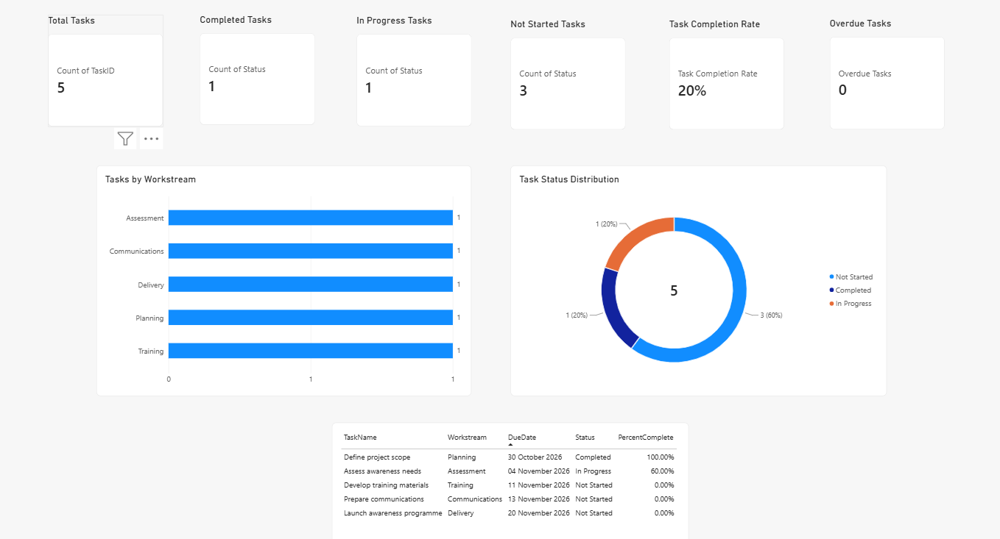
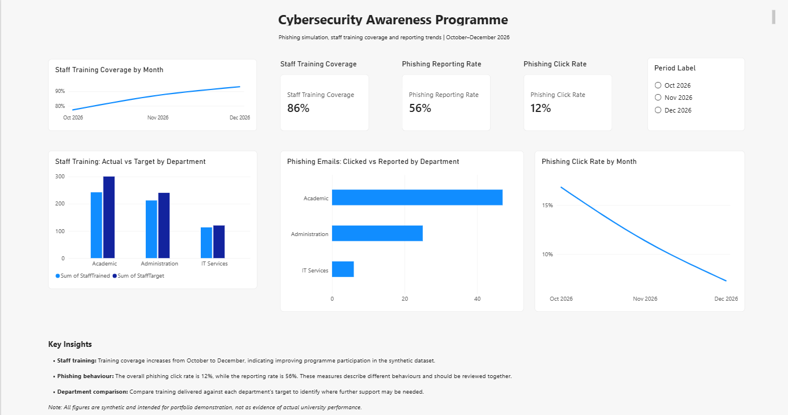

# University Phishing Awareness Programme Dashboard

A cybersecurity project management and data analytics portfolio project demonstrating how Excel VBA and Power BI can support the planning, monitoring and evaluation of a university phishing awareness programme.

The project combines project tracking, data validation, automation and interactive reporting using synthetic data.

## Project Overview

This project simulates a university initiative to improve staff awareness of phishing threats through training and phishing simulation activities.

The solution includes an Excel-based project tracker with VBA automation and a Power BI report containing two dashboard pages: Project Overview and Cybersecurity Awareness Metrics.

The project was developed to demonstrate practical skills in cybersecurity, project management, data quality assurance and business intelligence.

## Project Objectives

- Develop an Excel tracker to monitor project tasks, deadlines, priorities and completion status.
- Use VBA to automate task counting and validate project data.
- Build Power BI dashboards to communicate project progress and cybersecurity awareness metrics.
- Create DAX measures to calculate completion rates, training coverage, phishing click rates and reporting rates.
- Apply data validation and quality checks to improve the reliability of reporting.
- Document the project through structured project management artefacts and a GitHub repository.

## Tools and Technologies

| Tool / Technology | Application |
|---|---|
| Microsoft Excel | Project tracking, structured data tables, formulas, data validation and conditional formatting. |
| VBA | Task-counting and project data validation macros. |
| Power BI Desktop | Interactive dashboards, KPI cards, charts, tables and reporting-period filters. |
| DAX | Measures for task completion, overdue tasks, training coverage and phishing metrics. |
| CSV | Structured datasets for project tracking and awareness reporting. |
| GitHub | Version-controlled portfolio files, documentation and dashboard screenshots. |
| Markdown | Project documentation and repository guides. |

## Dashboard Preview

### 1. Project Overview



The project overview dashboard provides a summary of project delivery and task progress, including:

- Total tasks and task status distribution.
- Task completion rate.
- Tasks grouped by workstream.
- Task deadlines and progress.
- Overdue task monitoring.

### 2. Cybersecurity Awareness Metrics



The awareness dashboard analyses synthetic training and phishing simulation data, including:

- Staff training coverage against target.
- Phishing email click and reporting rates.
- Department-level comparisons.
- Monthly performance trends.
- Reporting-period filtering.

## Key Metrics

The dashboard demonstrates how key performance indicators (KPIs) can support project monitoring and cybersecurity awareness reporting.

| Metric | Purpose |
|---|---|
| Task Completion Rate | Measures the proportion of project tasks marked as completed. |
| Overdue Tasks | Counts incomplete tasks with deadlines before the current date. |
| Staff Training Coverage | Measures staff trained against the staff training target. |
| Phishing Click Rate | Measures the proportion of simulated phishing emails clicked. |
| Phishing Reporting Rate | Measures the proportion of simulated phishing emails reported. |

The current synthetic dataset produces illustrative overall values of **20% task completion, 86% staff training coverage, 12% phishing click rate and 56% phishing reporting rate**. These values are examples from the current dataset, not real institutional results.

## Repository Structure

```text
university-phishing-awareness-dashboard/
├── data/
│   ├── project-tasks.csv
│   ├── awareness-metrics.csv
│   └── README.md
├── docs/
│   ├── images/
│   │   ├── project-overview.png
│   │   └── awareness-metrics.png
│   ├── README.md
│   ├── project-charter.md
│   ├── requirements.md
│   ├── work-breakdown-structure.md
│   ├── test-plan.md
│   ├── risk-register.csv
│   └── raci-matrix.csv
├── .gitignore
└── README.md
```

*This tree is illustrative. Adjust it to match the files and folders actually present in your repository.*

## Project Documentation

The `docs/` folder contains supporting project management and technical documentation.

| Document | Purpose |
|---|---|
| `project-charter.md` | Defines the project purpose, objectives, scope and deliverables. |
| `requirements.md` | Documents the project requirements and intended functionality. |
| `work-breakdown-structure.md` | Breaks the project into phases, work packages and deliverables. |
| `test-plan.md` | Describes testing and validation activities. |
| `risk-register.csv` | Records project risks and planned responses. |
| `raci-matrix.csv` | Defines project responsibilities using the RACI framework. |

The `data/` folder contains the synthetic CSV datasets used in the project.

## Technical Implementation

### Excel and VBA

The Excel project tracker uses a structured task table to manage task IDs, workstreams, owners, due dates, statuses, priorities and completion percentages.

VBA macros support routine project management and data quality checks:

- `TestMyFirstMacro` — tests basic VBA execution.
- `CountProjectTasks` — counts project tasks.
- `ValidateProjectTasks` — checks project task data for validation issues.

Data validation, conditional formatting and summary formulas help communicate progress and identify data entry problems.

### Power BI and DAX

Power BI imports the project task and awareness metrics datasets to create interactive reports.

DAX measures calculate task completion, overdue tasks, staff training coverage, phishing click rate and phishing reporting rate. Visuals present these indicators through KPI cards, charts, tables and reporting-period filters.

The awareness dashboard supports comparisons across departments and reporting periods, allowing users to explore differences in training participation and simulated phishing behaviour.

## Learning Outcomes

This project demonstrates practical application of:

- **Cybersecurity:** interpreting phishing awareness and reporting indicators.
- **Project management:** defining scope, breaking down work, tracking deadlines and documenting risks.
- **Data analytics:** structuring datasets, calculating KPIs and interpreting trends.
- **Automation:** using VBA to reduce repetitive checks and validate task records.
- **Business intelligence:** designing Power BI reports to communicate operational information.
- **Data quality assurance:** checking data consistency, calculations and visual behaviour.
- **Technical documentation:** maintaining clear project artefacts and organising work in GitHub.

## Limitations

- All datasets are synthetic and intended for portfolio demonstration.
- The project does not conduct live phishing campaigns or connect to real university systems.
- The dashboards illustrate monitoring and reporting techniques; they do not establish the effectiveness of a real cybersecurity awareness programme.
- The overdue task measure is based on the current date and task status.
- Results depend on the completeness and accuracy of the input datasets.

## Data Disclaimer

This project uses synthetic data only. It contains no actual university staff records and does not represent real institutional finances, cybersecurity incidents or awareness performance.
